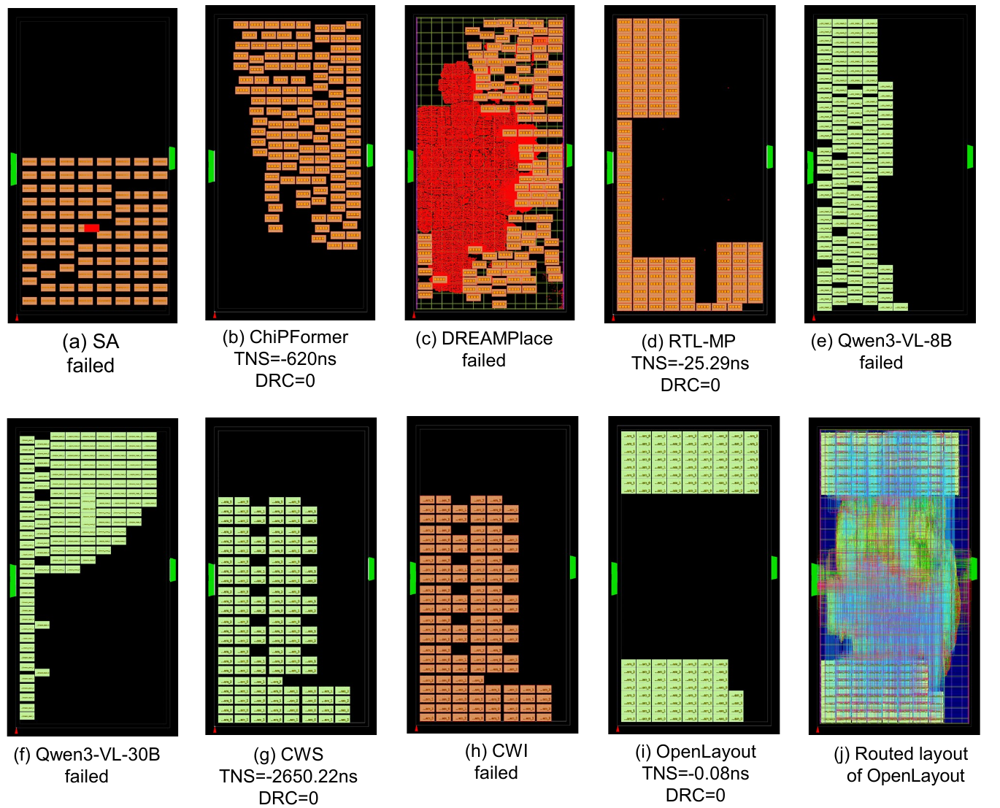

# OpenLayout (open-source)

**End-to-end physical design done by AI.** OpenLayout lets AI agents take a
netlist from floorplan to a routed, timing-clean layout on **OpenROAD**
(Nangate45) — no human in the loop. The agents plan macro placement, run
every stage, read the reports and layout images, diagnose what went wrong,
and iterate until the design goal (timing met, DRC clean, …) is reached or
the budget is spent. The open-source tools do the computation; the AI does
the engineering judgment.

```
floorplan -> macro_place -> detail_place -> cts -> route -> finish
              (candidate                (each stage: Worker -> Debugger -> Optimizer)
               sampling)
```

The same flow can be driven two ways (details in [Two ways to run](#two-ways-to-run)):

1. **API-driven framework** (`run_openlayout.py`) — a Python orchestrator
   calls an LLM through an OpenAI-compatible API for every agent decision.
2. **Coding-agent driven** (`Instructions/macro_placement_loop.md`) — a
   coding agent such as Claude Code or Codex *is* the Planner / Checker /
   Optimizer: it reads the skills, runs OpenROAD, looks at the images and
   closes the optimization loop itself.

Both share the same skill library and the same gates, so results are
comparable.

- **macro_place**: samples N macro-placement candidates (macroflow), gets
  PPA/DRC feedback for each from the *same simple downstream scripts*
  (detail place, CTS, light route), selects the best, then the flow
  proceeds. Skipped automatically when the design has no macros. Every
  candidate's coordinates are passed through the force-directed macro
  legalizer (`legalize.py`: overlap removal + core clamping, macro sizes and
  core bbox taken from the floorplan facts) before they are applied.
- **Worker** gives the initial run of a stage from a proven TCL template.
- **Debugger** (LLM) checks the result against the design goal + stage
  checklist skill; it has one more budget unit than the Optimizer so it can
  re-check after the last optimizer action.
- **Optimizer** (LLM) learns from the attempt history and proposes multiple
  parameter suggestions that run **in parallel**; the best (goal score) is
  promoted. When budgets run out, the stage keeps its best result and the
  flow moves on — it never aborts.
- The LLM is reached through an API (OpenAI-compatible; a local vLLM server
  works via `llm.base_url`) — the local code collects data, attaches skills,
  and executes the model's returned actions. Agents may additionally request
  whitelisted **tool queries** (worst paths, clock skew, DRC summary, power,
  placement check …) that the system runs on the current checkpoint before
  the agent gives its final answer (`agents.allow_tool_queries`).
- Best-attempt selection follows the **priority order in the config**
  (`goal.priority`, timing first by default) — reorder to change what wins.
- Layout images are taken through the `image_snapshot` skill
  (`skills/skills_openroad_flow/image_snapshot/`) after every stage.

## Showcase

Macro placement of **ariane133** (Nangate45, 60% utilization, core aspect
ratio 2:1) by ten methods. The OpenLayout result was produced entirely by
the AI agents — placement, downstream flow, checking and optimization
loop — with no manual intervention. Each panel shows the macro placement result and
its post-route outcome: `failed` means the downstream flow could not
converge (DRC / timing), otherwise the total negative slack (TNS) and DRC
count are given. The last panel is the fully routed layout of the
OpenLayout result (TNS = -0.08 ns, DRC = 0).

<p align="center">
  
</p>

## Benchmark data

The design data is **not** in this repository (~589 MB). Fetch it from
HuggingFace into `Benchmark/PlaceReasoner-Bench/` before running:

```bash
pip install huggingface_hub
hf download fenggev566/PlaceReasoner-Bench \
  --repo-type dataset --local-dir Benchmark/PlaceReasoner-Bench
```

**PlaceReasoner-Bench** — 8 open-source designs on Nangate45, each at 60% core
utilization under two core aspect ratios (1:1 and 2:1), giving 16 placement
tasks: `ariane133`, `ariane81`, `bp_be`, `bp_fe`, `ethernet`, `swerv_wrapper`,
`vga_lcd`, `VeriGPU`. See [`Benchmark/README.md`](Benchmark/README.md) for the
design table (top module names, macro counts, clock periods) and layout.

## Two ways to run

### 1. API-driven framework

An OpenAI-compatible API key is required for the LLM agents — export
`$OPENAI_API_KEY`, or see [`API_key/README.md`](API_key/README.md) for the
key-file route used by parallel candidate workers.

```bash
python run_openlayout.py --config configs/bp_fe.yaml            # whole flow
python run_openlayout.py --config configs/bp_fe.yaml --stages detail_place cts
python run_openlayout.py --config configs/bp_fe.yaml --no-llm   # worker-only
```

### 2. Coding-agent driven (Claude Code / Codex)

No API glue: the coding agent itself plans, places, checks, and optimizes,
following the prompt in
[`Instructions/macro_placement_loop.md`](Instructions/macro_placement_loop.md).
It uses the same `skills/skills_Nangate45/` library (init, planner, checker,
detail place, CTS+route, PPA checker, optimizer) and the same two gates:

```
Info -> Plan -> Macro place -> [Gate A: placement check] -> Detail place
     -> CTS + Route -> [Gate B: timing/DRC] -> Optimizer -> back to Plan
```

```bash
cd OpenLayout
claude      # or: codex
> Read Instructions/macro_placement_loop.md and run it with DESIGN=bp_fe ASPECT=ar2.
```

The prompt fixes the fairness rules (only macro placement and halo are
optimized; downstream stages stay at skill defaults), the refinement budgets
(2 for Gate A, 4 for Gate B), and the deliverables (stage images, routed
ODB, per-iteration summary, runtime breakdown). Only the input variables at
the top of the file change between designs.

## Config (`configs/<design>.yaml`)

Everything editable lives there: input data dir / output dir, the design
goal (`timing_met`, `drc_clean`, optional area/power/IR limits), per-stage
optimizer budgets, number of parallel optimizer suggestions, macro-stage
candidate count, and the LLM provider/model/api-key file.

Technology files are separate from the design data: `tech.dir`
(default `Digital_lib/Nangate45`) holds the PDK — `lib/NangateOpenCellLibrary_typical.lib`,
`lef/NangateOpenCellLibrary.tech.lef`, `lef/NangateOpenCellLibrary.macro.mod.lef` —
while design-specific macro LEF/LIB (fakeram, custom blocks) stay in
`design.data_dir/{lef,lib}`. The path reaches every TCL template as
`tech_dir` and the macroflow subprocess as `--tech-dir`.

## Outputs (under `paths.output_dir`)

| File | Content |
|---|---|
| `report.md`, `final_metrics.json` | final PPA, wirelength, DRC, IR, goal check, token usage, model+tool runtime |
| `telemetry.json` | per-stage tokens / LLM calls / runtimes |
| `design_context.json` | COMPACT current snapshot: circuit facts + per-stage {status, params, metrics, key_issues, last_action} — updated in place, never appended |
| `design_context_history.jsonl` | append-only audit trail (attempts, superseded actions/issues); each stage's Optimizer is fed back only its OWN stage's entries |
| `dialogs/<stage>/` | every agent conversation (system/user/response) for inspection |
| `saves_db/`, `reports/`, `logs/`, `generated_scripts/` | ODB checkpoints, tool reports, tool logs, rendered TCL |
| `macro_place/` | macroflow run + per-candidate downstream evaluations |

## Skills

- `skills/skills_openroad_flow/` — whole-flow skill library (path set by
  `skills.flow_dir` in the config). Per-stage directories, each holding
  `SKILL.md` (shared stage knowledge), `DEBUGGER.md` (checklist),
  `OPTIMIZER.md` (knob map) and optional `template/*.tcl` executables
  (e.g. `image_snapshot`). Adding a stage = adding a directory.
- `skills/skills_Nangate45/` — macro-placement skills + proven TCL
  templates (merged from the macro project).

## Layout

```
run_openlayout.py        entry point
openlayout/              framework (config, llm, runner, metrics, agents,
                         stages, flow, telemetry, design_context, skills)
openlayout/scripts/      parameterized stage TCL templates
macroflow/ + run_flow.py merged macro-placement system
legalize.py              force-directed macro legalizer (used by both systems)
Digital_lib/Nangate45/   PDK files (std-cell lib, tech LEF, cell LEF) — tech.dir
configs/bp_fe.yaml       reference design config (budgets=3, goal=timing+DRC)
Instructions/            prompts for coding agents (Claude Code / Codex) that
                         run the optimization loop without the API framework
docs/images/             figures used in this README
```
